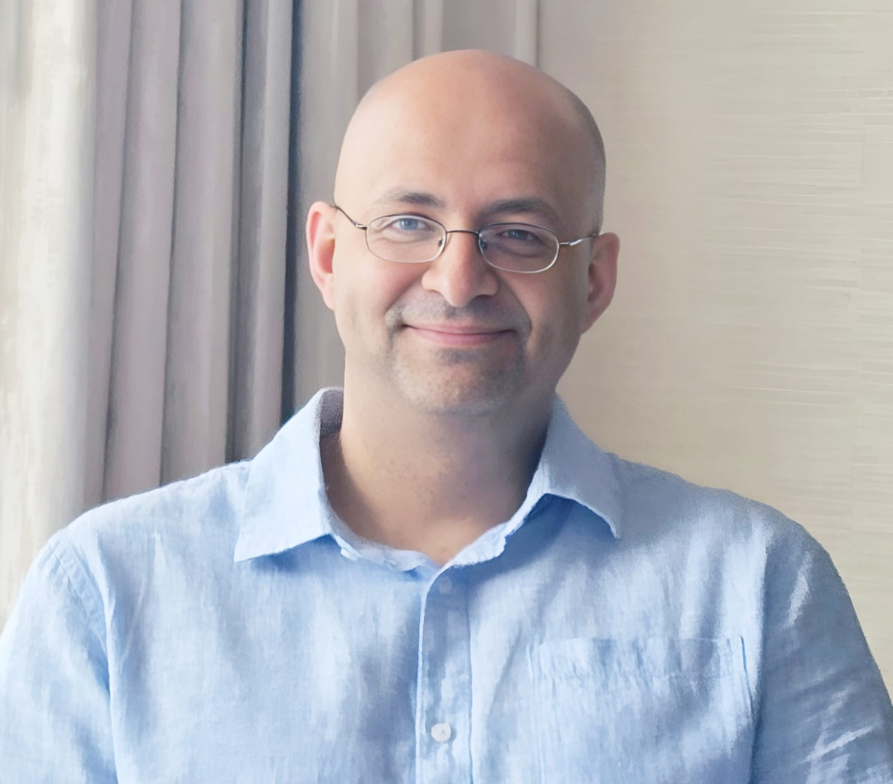

## Biography

<figure class="about-profile">
  
  <figcaption>Ahmed Elmokadem</figcaption>
</figure>

I am a pharmacometrician and serve as Director, MIDD AI/ML, with a PhD in Biomedical Sciences from the University of Connecticut. My work applies quantitative modeling and simulation across therapeutic areas including cancer, diabetes, and COVID-19. My experience spans quantitative systems pharmacology (QSP), physiologically based pharmacokinetics (PBPK), population pharmacokinetics/pharmacodynamics (PK/PD), Bayesian inference, and machine learning.

I use Julia and R extensively for scientific computing and modeling. I am also interested in the intersections of science, philosophy, and religion, as well as mathematics and its history.

I write fiction and nonfiction, including books that bring complex ideas to a broad audience. See the [Books page](books/index.qmd) for more.

[Download my CV](/files/cv.pdf){target="_blank" .btn .btn-primary}

## Teaching & Mentoring

I serve as an adjunct professor at the University of Connecticut and Indiana University. I enjoy helping students and colleagues build strong foundations in quantitative modeling, scientific programming, and clear scientific communication.

## Affiliations

- [International Society of Pharmacometrics (ISoP)](https://www.isop.org/)
- [American Society for Clinical Pharmacology and Therapeutics (ASCPT)](https://www.ascpt.org/)

## Personal Life

Outside of work, I enjoy exploring big questions in science, philosophy, religion, and politics with my family. I also treasure playing video games with my son.
