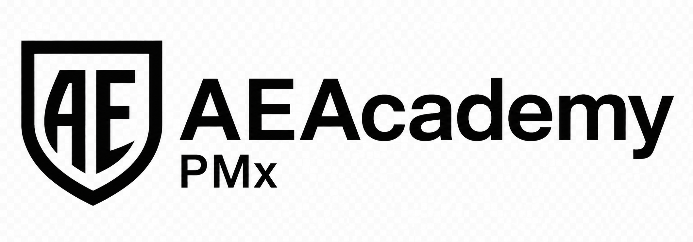

I created two online learning platforms with a shared focus on clear explanations, structured learning, and practical understanding. AEAcademy PMx serves learners in pharmacometrics, while AEAcademy Prep helps students build their SAT and ACT math skills.

  <section class="academy-card">
    
    <h2>AEAcademy PMx</h2>
    
Practical, theory-informed courses in pharmacometrics, from pharmacokinetic foundations and noncompartmental analysis to population PK/PD modeling and simulation. The courses emphasize clear reasoning, reproducible workflows, and decision-focused learning.

    
<a class="btn btn-primary" href="https://aeacademypmx.com" target="_blank" rel="noopener noreferrer">Explore AEAcademy PMx</a>

  </section>

  <section class="academy-card">
    
    <h2>AEAcademy Prep</h2>
    
Structured SAT and ACT math preparation focused on understanding, not memorizing shortcuts. Students learn through clear lessons, worked examples, targeted practice, and step-by-step solutions.

    
<a class="btn btn-primary" href="https://aeacademyprep.com" target="_blank" rel="noopener noreferrer">Explore AEAcademy Prep</a>

  </section>

